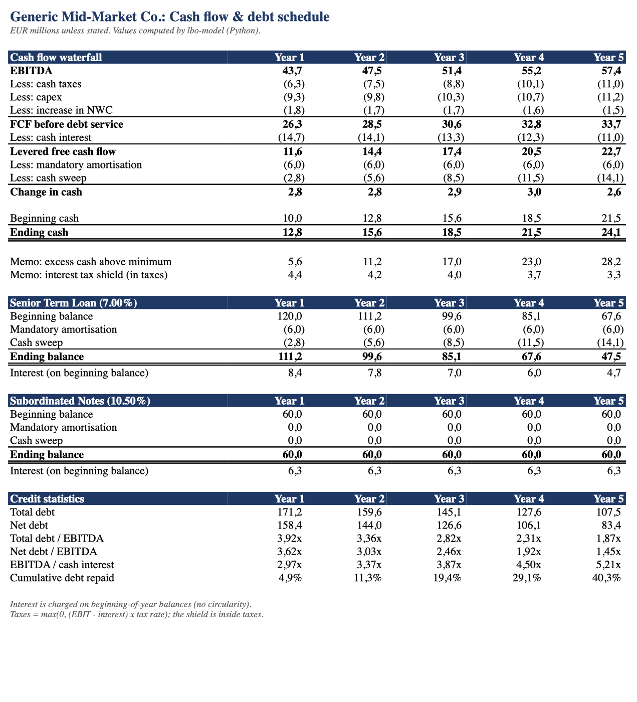
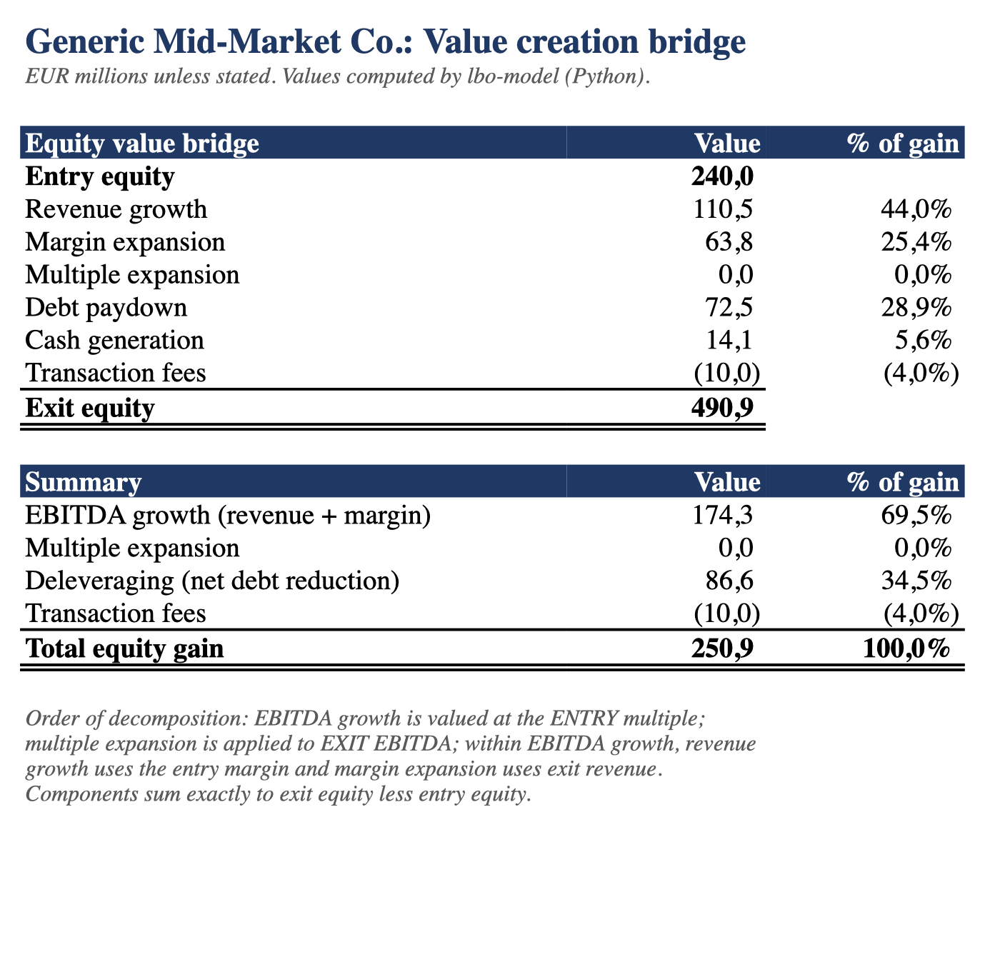

# lbo-model

**A transparent leveraged buyout model in Python that turns a YAML file of deal assumptions into sources & uses, a debt schedule with cash sweep, IRR/MOIC, a value creation bridge and a formatted Excel workbook.**

[](https://github.com/robinrhs/lbo-model/actions/workflows/ci.yml)


## What is an LBO?

In a leveraged buyout, a private equity sponsor buys a company and funds a large part of the purchase price with debt that is secured on the company itself. Over the holding period the company's cash flow pays interest and repays that debt, so a growing share of the enterprise value belongs to the equity holders. At exit, the sponsor sells the company, repays the remaining debt, and the return on the (comparatively small) equity cheque is measured as IRR and MOIC.

## Why this project

Spreadsheet LBOs are the standard tool in private equity, but their logic is spread across hundreds of cells. This repository writes the same mechanics as small, documented, tested Python functions, so that every number can be traced back to one formula and one assumption. It is a learning and demonstration project: the example company and all numbers are fictional.

What it does:

- reads and validates all assumptions from one YAML file (clear error messages for typos or implausible inputs)
- builds sources & uses, including transaction fees and minimum cash
- projects revenue, EBITDA, D&A, capex and working capital
- runs a cash flow waterfall and a per-tranche debt schedule: interest, mandatory amortisation, then a cash sweep in seniority order
- computes exit equity, IRR and MOIC
- splits the equity gain into revenue growth, margin expansion, multiple expansion, debt paydown, cash generation and fees, summing exactly to the total gain
- produces an entry x exit multiple sensitivity grid for IRR and MOIC
- prints a summary in the terminal and exports a formatted Excel workbook

## Quickstart

Requires [uv](https://docs.astral.sh/uv/) and Python 3.11+.

```bash
git clone https://github.com/robinrhs/lbo-model.git
cd lbo-model
uv sync

# print the summary
uv run python -m lbo run config/example.yaml

# ... and export the Excel workbook
uv run python -m lbo run config/example.yaml --excel output/lbo_example.xlsx

# tests and linting
uv run pytest
uv run ruff check . && uv run ruff format --check .
```

To model your own case, copy `config/example.yaml`, change the numbers and run the command on the new file.

## Example output

Output of `uv run python -m lbo run config/example.yaml` for the fictional example company (EUR millions): 40.0 LTM EBITDA bought at 10.0x, 4.5x leverage, exit at 10.0x after five years.

**Sources & uses**

| Uses | Amount | Sources | Amount |
| --- | ---: | --- | ---: |
| Purchase enterprise value | 400.0 | Senior Term Loan (3.0x) | 120.0 |
| Transaction fees | 10.0 | Subordinated Notes (1.5x) | 60.0 |
| Minimum cash | 10.0 | Sponsor equity | 240.0 |
| **Total uses** | **420.0** | **Total sources** | **420.0** |

**Returns**

| | Value |
| --- | ---: |
| Exit EBITDA (year 5) | 57.4 |
| Exit enterprise value (10.0x) | 574.3 |
| Less: net debt at exit | (83.4) |
| Exit equity value | 490.9 |
| Equity invested | 240.0 |
| **MOIC** | **2.05x** |
| **IRR (5-year hold)** | **15.4%** |

**Value creation bridge**

| Driver | EURm | % of gain |
| --- | ---: | ---: |
| Revenue growth | 110.5 | 44.0% |
| Margin expansion | 63.8 | 25.4% |
| Multiple expansion | - | 0.0% |
| Debt paydown | 72.5 | 28.9% |
| Cash generation | 14.1 | 5.6% |
| Transaction fees | (10.0) | -4.0% |
| **Total equity gain** | **250.9** | **100.0%** |

**IRR sensitivity** (rows: entry multiple, columns: exit multiple)

| Entry \ Exit | 9.00x | 9.50x | 10.00x | 10.50x | 11.00x |
| --- | ---: | ---: | ---: | ---: | ---: |
| 9.00x | 16.8% | 18.4% | 19.8% | 21.2% | 22.5% |
| 9.50x | 14.6% | 16.1% | 17.5% | 18.8% | 20.1% |
| 10.00x | 12.5% | 14.0% | **15.4%** | 16.7% | 18.0% |
| 10.50x | 10.7% | 12.1% | 13.5% | 14.8% | 16.0% |
| 11.00x | 9.1% | 10.5% | 11.8% | 13.1% | 14.3% |

<details>
<summary>Full terminal output</summary>

```text
LBO model: Generic Mid-Market Co.
Entry 10.00x LTM EBITDA of 40.0 | leverage 4.50x | exit 10.00x after 5 years

Sources & Uses (EURm)
┏━━━━━━━━━━━━━━━━━━━━━━━━━━━┳━━━━━━━━┳━━━━━━━━━━━━━━━━━━━━┳━━━━━━━━┓
┃ Uses                      ┃ Amount ┃ Sources            ┃ Amount ┃
┡━━━━━━━━━━━━━━━━━━━━━━━━━━━╇━━━━━━━━╇━━━━━━━━━━━━━━━━━━━━╇━━━━━━━━┩
│ Purchase enterprise value │  400.0 │ Senior Term Loan   │  120.0 │
│ Transaction fees          │   10.0 │ Subordinated Notes │   60.0 │
│ Minimum cash              │   10.0 │ Sponsor equity     │  240.0 │
├───────────────────────────┼────────┼────────────────────┼────────┤
│ Total uses                │  420.0 │ Total sources      │  420.0 │
└───────────────────────────┴────────┴────────────────────┴────────┘

Projection & debt schedule (EURm)
┏━━━━━━━━━━━━━━━━━━━━━━━━┳━━━━━━━━┳━━━━━━━━┳━━━━━━━━┳━━━━━━━━┳━━━━━━━━┓
┃                        ┃     Y1 ┃     Y2 ┃     Y3 ┃     Y4 ┃     Y5 ┃
┡━━━━━━━━━━━━━━━━━━━━━━━━╇━━━━━━━━╇━━━━━━━━╇━━━━━━━━╇━━━━━━━━╇━━━━━━━━┩
│ Revenue                │  265.0 │  279.6 │  293.6 │  306.8 │  319.0 │
│ EBITDA                 │   43.7 │   47.5 │   51.4 │   55.2 │   57.4 │
│ Cash interest          │ (14.7) │ (14.1) │ (13.3) │ (12.3) │ (11.0) │
│ Cash taxes             │  (6.3) │  (7.5) │  (8.8) │ (10.1) │ (11.0) │
│ Capex                  │  (9.3) │  (9.8) │ (10.3) │ (10.7) │ (11.2) │
│ Increase in NWC        │  (1.8) │  (1.7) │  (1.7) │  (1.6) │  (1.5) │
│ Levered free cash flow │   11.6 │   14.4 │   17.4 │   20.5 │   22.7 │
│ Debt repayment         │  (8.8) │ (11.6) │ (14.5) │ (17.5) │ (20.1) │
│ Ending debt            │  171.2 │  159.6 │  145.1 │  127.6 │  107.5 │
│ Ending cash            │   12.8 │   15.6 │   18.5 │   21.5 │   24.1 │
├────────────────────────┼────────┼────────┼────────┼────────┼────────┤
│ EBITDA margin          │  16.5% │  17.0% │  17.5% │  18.0% │  18.0% │
│ Net debt / EBITDA      │  3.62x │  3.03x │  2.46x │  1.92x │  1.45x │
└────────────────────────┴────────┴────────┴────────┴────────┴────────┘

Returns (EURm)
┏━━━━━━━━━━━━━━━━━━━━━━━━┳━━━━━━━━┓
┃                        ┃  Value ┃
┡━━━━━━━━━━━━━━━━━━━━━━━━╇━━━━━━━━┩
│ Exit EBITDA            │   57.4 │
│ Exit multiple          │ 10.00x │
│ Exit enterprise value  │  574.3 │
│ Less: net debt at exit │ (83.4) │
│ Exit equity value      │  490.9 │
│ Equity invested        │  240.0 │
├────────────────────────┼────────┤
│ MOIC                   │  2.05x │
│ IRR (5-year hold)      │  15.4% │
└────────────────────────┴────────┘

Value creation bridge (EURm)
┏━━━━━━━━━━━━━━━━━━━━┳━━━━━━━━┳━━━━━━━━━━━┓
┃                    ┃  Value ┃ % of gain ┃
┡━━━━━━━━━━━━━━━━━━━━╇━━━━━━━━╇━━━━━━━━━━━┩
│ Revenue growth     │  110.5 │     44.0% │
│ Margin expansion   │   63.8 │     25.4% │
│ Multiple expansion │      - │      0.0% │
│ Debt paydown       │   72.5 │     28.9% │
│ Cash generation    │   14.1 │      5.6% │
│ Transaction fees   │ (10.0) │     -4.0% │
├────────────────────┼────────┼───────────┤
│ Total equity gain  │  250.9 │    100.0% │
└────────────────────┴────────┴───────────┘

IRR sensitivity: entry multiple (rows) x exit multiple
┏━━━━━━━━━━━━━━┳━━━━━━━┳━━━━━━━┳━━━━━━━━┳━━━━━━━━┳━━━━━━━━┓
┃ Entry \ Exit ┃ 9.00x ┃ 9.50x ┃ 10.00x ┃ 10.50x ┃ 11.00x ┃
┡━━━━━━━━━━━━━━╇━━━━━━━╇━━━━━━━╇━━━━━━━━╇━━━━━━━━╇━━━━━━━━┩
│ 9.00x        │ 16.8% │ 18.4% │  19.8% │  21.2% │  22.5% │
│ 9.50x        │ 14.6% │ 16.1% │  17.5% │  18.8% │  20.1% │
│ 10.00x       │ 12.5% │ 14.0% │  15.4% │  16.7% │  18.0% │
│ 10.50x       │ 10.7% │ 12.1% │  13.5% │  14.8% │  16.0% │
│ 11.00x       │  9.1% │ 10.5% │  11.8% │  13.1% │  14.3% │
└──────────────┴───────┴───────┴────────┴────────┴────────┘
```

</details>

## Excel workbook

`--excel` writes one sheet per schedule: **Assumptions, Sources & Uses, Projection, Debt Schedule, Returns, Bridge, Sensitivity**. Inputs are in blue font, calculations in black, negatives in brackets, multiples as `x`; header rows and the label column are frozen. A generated copy for the example case is in [`docs/example_output.xlsx`](docs/example_output.xlsx).

<!-- TODO screenshot: replace with a real Microsoft Excel screenshot of the Debt Schedule sheet (docs/images/excel_debt_schedule.png) -->

The previews below are macOS Quick Look renderings of the exported sheets (generated headlessly, so fonts and the decimal separator follow the local system settings rather than Excel):

<p>
  
  
</p>

The workbook contains the **values** computed in Python, not live Excel formulas. Python and its tests are the single source of truth; the workbook is the presentation layer.

## Method

All amounts in EUR millions; *t* = 1 … *N* are projection years, *t* = 0 is closing.

### 1. Sources & uses

```
Purchase EV     = LTM EBITDA x entry multiple
Fees            = Purchase EV x fee %
Total uses      = Purchase EV + fees + minimum cash
Debt_i          = LTM EBITDA x (x EBITDA)_i                    for each tranche i
Sponsor equity  = Total uses - sum of Debt_i                   (the plug)
```

The target is bought cash-free / debt-free, so the minimum operating cash has to be funded at closing.

### 2. Operating projection

```
Revenue_t  = Revenue_{t-1} x (1 + g_t)
EBITDA_t   = Revenue_t x margin_t
D&A_t      = Revenue_t x D&A %
EBIT_t     = EBITDA_t - D&A_t
Capex_t    = Revenue_t x capex %
dNWC_t     = (Revenue_t - Revenue_{t-1}) x NWC %
```

### 3. Cash flow waterfall and debt schedule

```
Interest_t        = sum_i  rate_i x BeginningBalance_{i,t}
Cash taxes_t      = max(0, (EBIT_t - Interest_t) x tax rate)
FCF before debt_t = EBITDA_t - Cash taxes_t - Capex_t - dNWC_t
Levered FCF_t     = FCF before debt_t - Interest_t

Mandatory_{i,t}   = min(amort %_i x OriginalPrincipal_i, BeginningBalance_{i,t})
Excess cash_t     = max(0, Cash_{t-1} + Levered FCF_t - sum_i Mandatory_{i,t} - minimum cash)
Sweep_t           = sweep % x Excess cash_t, paid to sweepable tranches in seniority order
EndingBalance_i,t = BeginningBalance_{i,t} - Mandatory_{i,t} - Sweep_{i,t}
Cash_t            = Cash_{t-1} + Levered FCF_t - sum_i (Mandatory_{i,t} + Sweep_{i,t})
```

- **Interest convention:** interest is charged on the **beginning-of-year** balance. This avoids the circular reference that average-balance interest creates (interest → cash flow → repayment → balance → interest). It slightly overstates interest in years with large repayments.
- **Cash sweep convention:** the sweep applies to the cash **balance** above minimum cash, including cash retained in earlier years. Cash that is not swept in one year is partly swept again in the next, so over the hold the lenders receive more than 50% of the cumulative excess cash. Credit agreements usually define an *excess cash flow* sweep on the year's flow only; with a 100% sweep the two definitions coincide. The choice affects only the split between debt paydown and cash build-up (and therefore interest), not net debt at the time of each sweep.
- **Interest tax shield:** interest is deducted before tax, so the shield (`tax rate x interest`, as long as pre-tax income is positive) is **already inside cash taxes**. The Debt Schedule sheet shows it as a memo line; it is never subtracted a second time.

### 4. Exit and returns

```
Exit EV        = EBITDA_N x exit multiple
Exit equity    = Exit EV - (Debt_N - Cash_N)
MOIC           = Exit equity / Sponsor equity
IRR            = r such that  -Sponsor equity + Exit equity / (1 + r)^N = 0
```

IRR is solved numerically by bisection (and checked against `numpy_financial.irr` in the tests). With no interim dividends, IRR = MOIC^(1/N) - 1.

### 5. Value creation bridge

Starting from `Gain = Exit equity - Entry equity = (EV_N - EV_0) + (NetDebt_0 - NetDebt_N) - Fees`, the change in EV is decomposed in a fixed order:

```
Revenue growth      = (Revenue_N - Revenue_0) x margin_0 x multiple_0
Margin expansion    = Revenue_N x (margin_N - margin_0) x multiple_0
Multiple expansion  = (multiple_N - multiple_0) x EBITDA_N
Debt paydown        = Debt_0 - Debt_N
Cash generation     = Cash_N - Cash_0
Transaction fees    = -Fees
```

EBITDA growth is valued at the **entry** multiple and multiple expansion on **exit** EBITDA, so the interaction term (more EBITDA x higher multiple) is attributed to the multiple. Other orderings are possible and would shift value between the bars; the total is identical. The components sum exactly to the equity gain, which is checked by the tests.

### 6. Sensitivity

The full model is re-run for every combination of entry multiple (rows) and exit multiple (columns). Debt is sized as x EBITDA, so a higher entry price is funded entirely with additional equity. The centre cell equals the base case.

## Key assumptions (example case)

| Assumption | Value | Comment |
| --- | --- | --- |
| LTM revenue / EBITDA | 250.0 / 40.0 | 16.0% margin |
| Entry / exit multiple | 10.0x / 10.0x | no multiple expansion assumed |
| Revenue growth | 6.0% → 4.0% | decelerating |
| EBITDA margin | 16.5% → 18.0% | modest operational improvement |
| D&A / capex | 3.0% / 3.5% of revenue | |
| NWC | 12% of revenue growth | |
| Tax rate | 30% | roughly German corporate + trade tax |
| Senior Term Loan | 3.0x, 7.0%, 5% amortisation p.a., sweepable | |
| Subordinated Notes | 1.5x, 10.5%, bullet, non-call | |
| Cash sweep | 50% of cash above minimum | balance-based, see method |
| Fees / minimum cash | 2.5% of EV / 10.0 | |

## Limitations

This is a deliberately simple model. It does **not** include:

- a revolving credit facility (the model stops with an error if cash would turn negative), PIK interest, floating rates, hedging, OID or financing fees amortised over the loan life
- interest income on cash, dividend recaps or interim distributions
- tax loss carry-forwards, interest deductibility limits (e.g. the German *Zinsschranke*), tax deductibility of fees or purchase price allocation / goodwill amortisation
- management equity, preferred equity or a waterfall between equity classes
- exit costs, or a distinction between LTM and NTM multiples at exit
- maturity dates and refinancing; all debt still outstanding is repaid at exit
- live Excel formulas (the workbook contains values)

Results are illustrative outputs of the stated assumptions. They are not a valuation of any real company and not investment advice.

## Project structure

```
lbo-model/
├── config/
│   └── example.yaml        # deal assumptions (inputs)
├── src/lbo/
│   ├── config.py           # YAML loading + validation (pydantic)
│   ├── transaction.py      # sources & uses
│   ├── projection.py       # revenue -> EBIT, capex, NWC
│   ├── debt.py             # cash flow waterfall, debt schedule, cash sweep
│   ├── returns.py          # exit equity, IRR, MOIC
│   ├── bridge.py           # value creation bridge
│   ├── deal.py             # runs one case end to end
│   ├── sensitivity.py      # entry x exit multiple grid
│   ├── model.py            # base case + sensitivity
│   ├── excel.py            # formatted workbook export (openpyxl)
│   ├── cli.py              # command line interface (rich)
│   └── __main__.py         # enables `python -m lbo`
├── tests/                  # pytest: hand-calculated case + invariants
├── docs/                   # example workbook and sheet previews
└── .github/workflows/ci.yml
```

The finance logic (`transaction`, `projection`, `debt`, `returns`, `bridge`) is free of any input/output code; the CLI and the Excel export only format the results.

## Tests

`uv run pytest` checks, among other things:

- a two-year deal calculated by hand line by line (see the docstring in `tests/test_hand_case.py`)
- sources equal uses
- debt is never negative, balances roll forward, the sweep respects seniority
- cash reconciles every year (beginning cash + levered FCF - repayments = ending cash)
- IRR matches `numpy_financial.irr`
- bridge components sum to the total equity gain
- the centre cell of the sensitivity grid equals the base-case IRR

## License

[MIT](LICENSE) © 2026 Robin-Philip Rehschuh
